# WallHaze 静态/动态壁纸体验与设备适配专项优化报告

- 日期：2026-10-24
- 范围：`apps/web`（Studio、Gallery、壁纸详情页、设备/媒体模型、i18n、演示资源与测试）；未改动钱包、支付、Google OAuth、Auth 核心规则
- 结论：**普通用户主流程、真实比例详情页、6 个可播放动态演示、媒体/设备筛选与设备信息已完成；Web 206 个测试、TypeScript、ESLint、Next build、API 220 个测试、Contracts 类型检查全部通过。** 未执行真实付费 AI、未提交 Git、未部署。

## 状态口径

- **已真实实现并验证**：代码已落地，类型/测试/构建通过，并在浏览器中实际观察到行为。
- **Mock 验证通过**：只验证了 Mock/本地路径，没有真实模型或真实付费请求。
- **仅界面实现**：界面与纯函数已实现，但缺少真实设备或真实 Provider 的端到端证据。
- **需要真实模型验证**：Adapter/调用链已存在，但没有发出真实付费请求。
- **存在阻塞**：当前环境或数据本身无法完成。

## 1. 普通用户的 Studio 主流程

**状态：已真实实现并验证。**

Studio 现在按普通用户的理解顺序呈现：

1. 壁纸类型：静态壁纸 / 动态壁纸（Studio 顶部切换）。
2. 风格：Studio 默认选中一个有效风格（`anime`，电影感动漫）；仍可取消或更换。
3. 创意描述：明确标为“可选”；留空时使用所选风格的默认场景。
4. 当前设备自动适配：主界面直接显示设备、比例、目标尺寸。
5. 生成按钮：空描述 + 默认风格时仍可用。

普通用户不再需要先选设备、比例、分辨率、参考图或灵感才能生成。浏览器实测：空描述时“生成壁纸”按钮可用，确认弹窗显示“仅使用风格模板——没有描述文字”、风格“电影感动漫”、设备“桌面”、比例 16:9、分辨率 1920 × 1080，未提交请求。

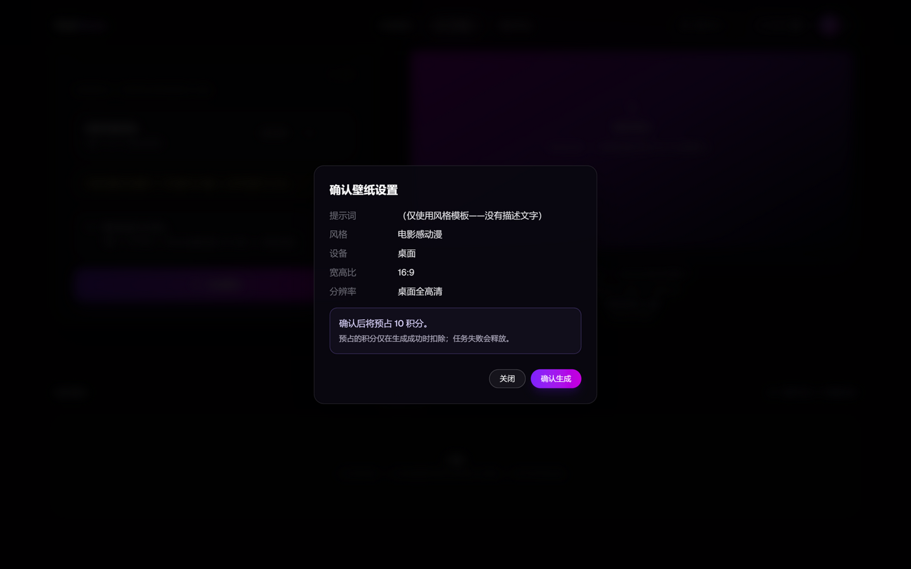

## 2. 默认风格与空描述

**状态：已真实实现并验证。**

- `STUDIO_DEFAULT_STYLE_ID = "anime"` 是 Studio 的唯一定义（`lib/studio/defaults.ts`），静态与动态 Studio 共用。
- 首页营销区的生成器仍保持“未选择风格”的原有行为，避免把 Studio 的默认值扩大到首页。
- `validatePromptPair("", "anime")` 返回有效；`validatePromptPair("", null)` 仍返回空错误。新增 3 个单测覆盖。
- 测试：`tests/studio-defaults.test.ts`。

## 3. 高级设置（默认收起、保留值、恢复推荐）

**状态：已真实实现并验证。**

- 设备、比例、分辨率、自定义尺寸、灵感、参考图统一收进“高级设置（可选）”，默认收起。
- 收起不会清空任何值：实测选择“手机”后收起再展开，`aria-pressed` 仍为 `true`。
- “恢复推荐设置”会重新读取屏幕、恢复推荐设备/比例/尺寸，并清除参考图；不会覆盖用户的风格、描述或运动描述。
- 静态 Studio 与动态 Studio 都使用同一套模式。

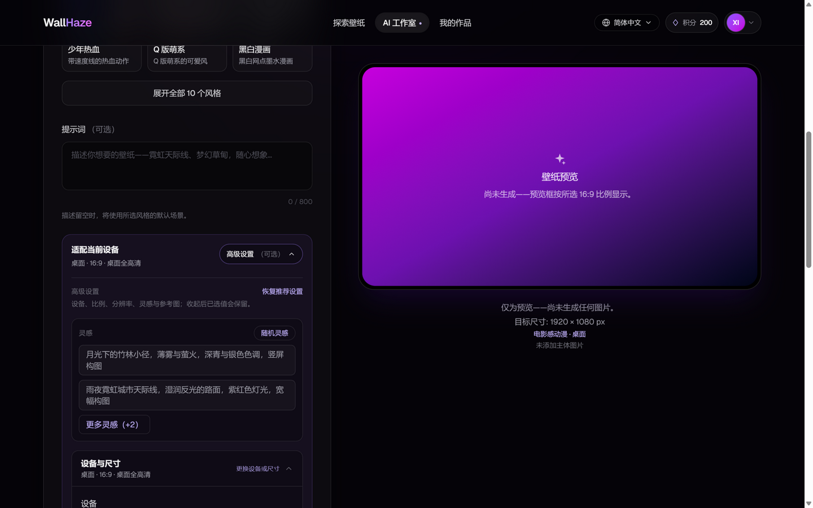

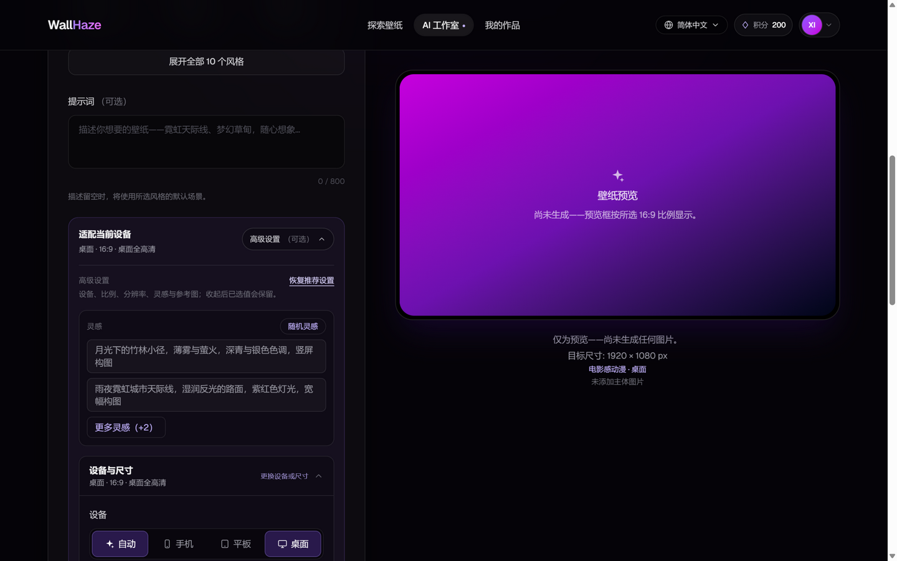

## 4. 静态壁纸详情页比例修复（本轮核心缺陷）

**状态：已真实实现并验证；有改造前/后截图。**

### 根因

旧详情页把图片放进固定 `aspect-[3/4]` 的容器，再对实际为 768×1368（9:16）或 576×1024 的竖图使用 `object-contain`。容器比例与文件比例不一致，左右出现明显的渐变空白条；页面也没有真实尺寸、原图适配设备和设备预览。

### 修复

- 使用实际 `width/height` 计算 `aspectRatio`，容器按文件真实比例渲染。
- 竖图限制最大宽度（`max-w-[26rem]`），避免竖图在桌面端被拉到过高。
- 图片保持 `object-contain`，不裁切、不拉伸、不补边。
- 详情页新增：真实尺寸（`768 × 1368 · 9:16`）、原生适配设备（手机）、下载说明（原始文件，不裁切/不补边/不放大）。
- JSON-LD 的 `width`/`height` 使用真实像素。
- 新增 39 张静态壁纸的实测尺寸表：首六张远程图 768×1368；`nebula-city` 1368×768；其余本地图 576×1024。

### 改造前

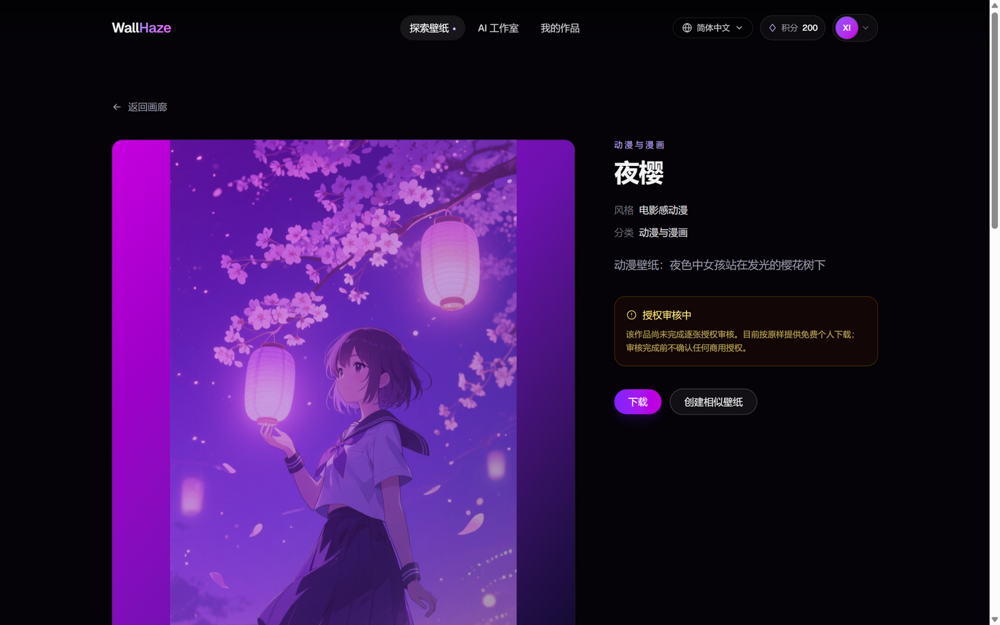

### 改造后

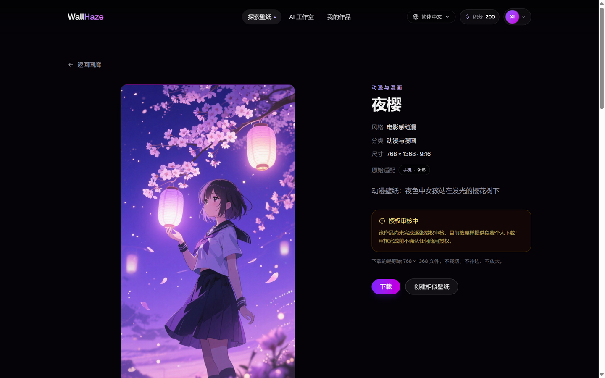

- 改造前：固定 3:4 舞台，左右渐变条，无尺寸与设备信息。
- 改造后：9:16 真实比例，无左右条带，尺寸/原生设备/下载说明完整。
- 390 手机：图片铺满内容宽度，无横向溢出。

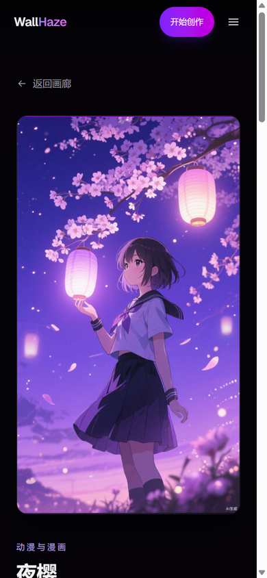

## 5. 原图 + 设备模拟预览

**状态：已真实实现并验证（模拟预览已明确标注）。**

- 主舞台展示**原始文件**。
- 下方“在你的设备上看看”提供手机 9:16、平板 3:4、桌面 16:9 三种 CSS 模拟框。
- 原生设备按钮带“原生”标记；非原生设备不带。
- 每个模拟框标注“{device}预览”，区域右上角写“仅效果预览”，正文明确说明：
  - 同一张原始文件放入设备框；
  - 设备框只是对比用的 CSS 模拟；
  - 不是可单独下载的适配文件。
- 模拟框使用 `object-cover` 只是视觉对比，不产生、不承诺任何裁切/补边文件。

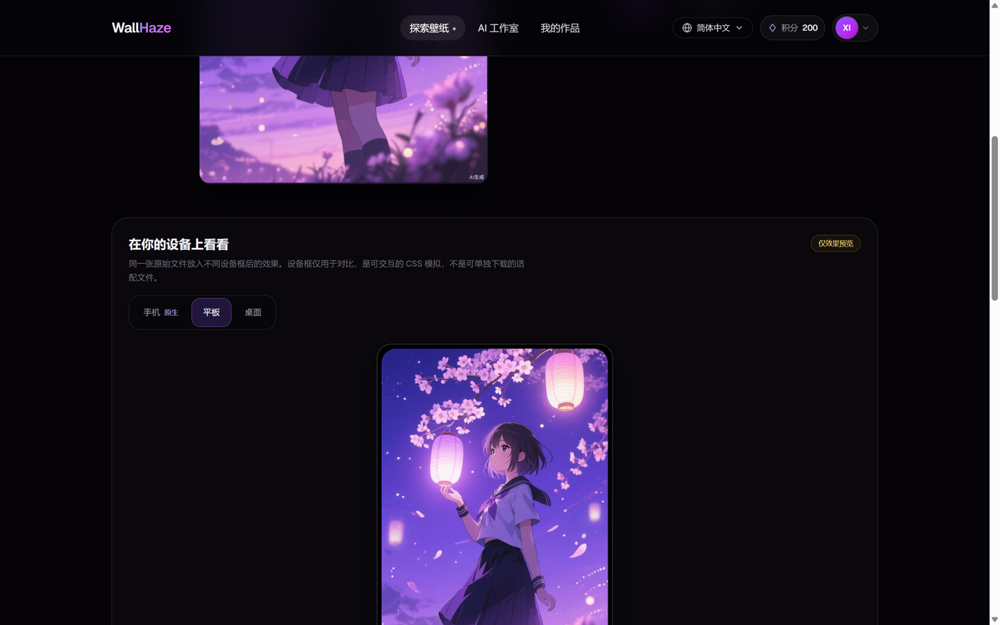

## 6. 六个真实可播放的动态演示

**状态：已真实实现并验证；演示为自制素材，不是 AI 输出。**

资源目录：`apps/web/public/videos/live-demos/`（MP4 + PNG Poster）。

| ID | 风格 | 尺寸 | 原生设备 | 时长 | MP4 大小 |
|---|---|---|---|---|---|
| sakura-drift | anime | 360×640 | 手机 | 5s | 21,059 B |
| neon-rain | cyberpunk | 640×360 | 桌面 | 5s | 31,345 B |
| meteor-shower | sci-fi | 360×640 | 手机 | 5s | 64,534 B |
| jellyfish-glow | nature | 480×480 | 平板 | 5s | 162,173 B |
| forest-light | nature | 640×360 | 桌面 | 5s | 20,531 B |
| sunset-clouds | cinematic | 640×360 | 桌面 | 5s | 153,060 B |

- 全部为浏览器 `MediaRecorder` 生成的无声 H.264 MP4，带真实 Poster。
- 清单元数据：`lib/live-demos.ts`，`kind: "demo"`，`license: "self-authored"`。
- 单测验证文件存在、`ftyp` 头、文件大小、Poster、时长、尺寸与原生设备一致：`tests/live-demos.test.ts`。

### 实际播放验证

在 Gallery 动态壁纸页点击播放后读取真实 `<video>` 状态：

```json
{
  "currentTime": 1.2,
  "duration": 5,
  "loop": true,
  "muted": true,
  "paused": false,
  "errorCode": null
}
```

继续等待 4.5 秒后：

```json
{
  "currentTime": 1.04,
  "duration": 5,
  "loop": true,
  "paused": false,
  "errorCode": null
}
```

说明视频真实播放、静音、循环回绕；不是静态占位图。播放中的截图：

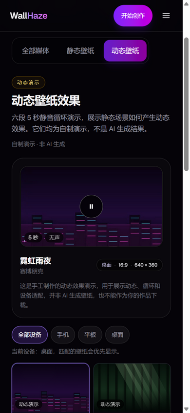

### 防止把演示误认为 AI 结果

Gallery、Studio 预览和每张演示卡均显示：

- “动态演示 / 自制演示 · 非 AI 生成”；
- “这是手工制作的动态效果演示……并非 AI 生成壁纸，也不能作为你的作品下载”；
- Studio 预览明确写“自制 5 秒演示，并非 AI 生成结果。生成完成后，你的视频会显示在这里”。

## 7. Gallery 的媒体与设备筛选

**状态：已真实实现并验证。**

- 媒体类型：**全部媒体 / 静态壁纸 / 动态壁纸**，默认“全部媒体”。
- 设备：**全部设备 / 手机 / 平板 / 桌面**。
- “全部设备”不隐藏任何内容，只把与当前设备原生匹配的媒体排到前面；选择具体设备才过滤。
- 静态卡展示“静态壁纸 + 原生设备 + 比例”；动态卡展示“动态演示 + 风格 + 原生设备 + 比例 + 时长”。
- 设备分类来自真实像素，不来自图片标签或人工声明。

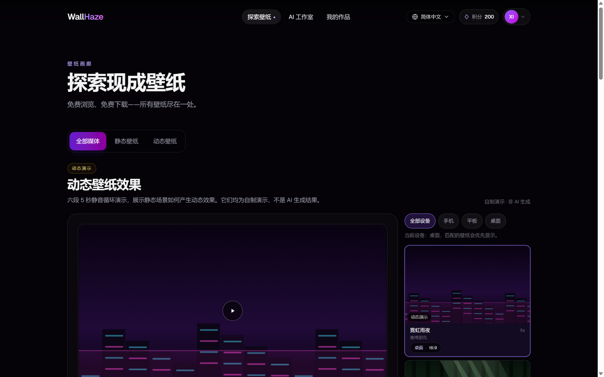

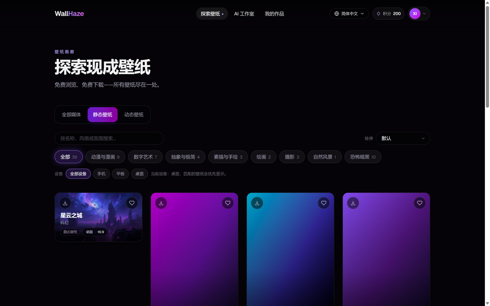

### 平板静态筛选的真实空状态

当前 39 张静态壁纸只有手机（9:16）和桌面（16:9）两种原生比例，没有 3:4/1:1 平板原生文件。选择“平板”时页面显示诚实的空状态，而不是伪造平板变体：

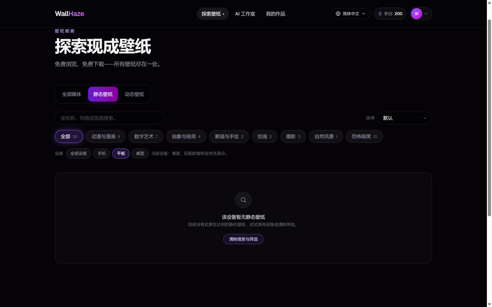

动态演示中有 1:1 平板原生示例（水母微光），因此平板筛选在动态页有真实内容：

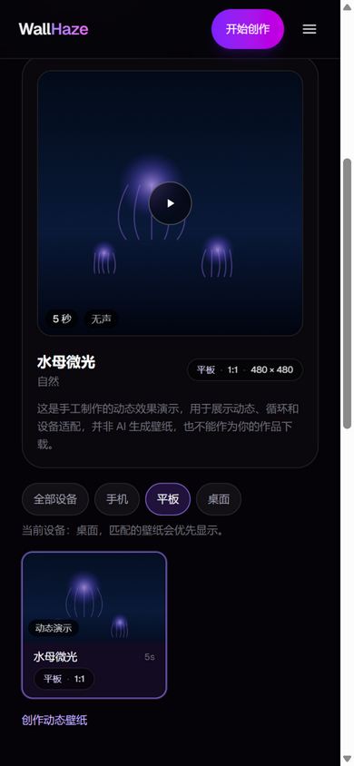

## 8. 动态 Studio 的普通用户入口

**状态：已真实实现并验证（Mock 市场能力；未提交真实视频请求）。**

- 顶部保留“静态壁纸 / 动态壁纸”类型切换。
- 动态模式保留“文字生成视频 / 图片生成视频”次级入口，对应“让我的图片动起来”。
- 风格默认有效；场景描述可选；运动描述、源图选择、设备、比例、时长收进高级设置。
- 主界面显示按当前屏幕与 Provider 能力推荐的结果：设备、比例、时长。
- 空状态不再是一块纯渐变：右侧直接播放一个真实自制演示，并带“演示”角标、时长、静音、比例、尺寸、风格、来源说明与演示切换器。
- 实测 1440×900：自动推荐桌面 16:9 5 秒，演示为 `neon-rain`；播放按钮、时长、静音、演示说明、演示选择器均可见。

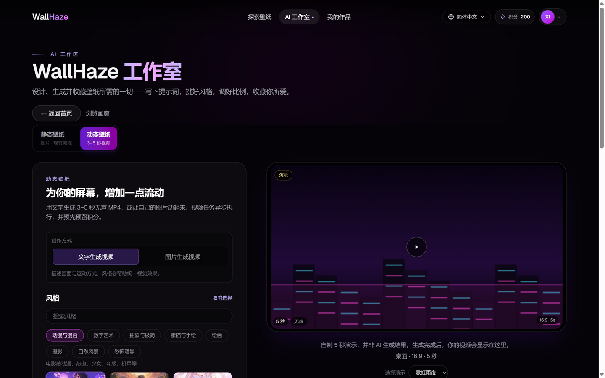

## 9. 设备推荐与 Provider 比例限制

**状态：已真实实现并验证（纯函数/浏览器）；真实手机/平板触摸设备需人工复核。**

- 静态设备推荐：`screen` CSS 像素 + `devicePixelRatio` + `innerWidth` + `maxTouchPoints`；估算物理像素仅作尺寸推荐，不冒充设备原生分辨率。
- 视频比例推荐：只从后端 capability matrix 返回的 Provider 支持比例中选择；先按横竖屏方向筛选，再选最接近的宽高比。竖屏平板不会被推荐 16:9；横屏手机不会被推荐 9:16。
- 修改 Provider/来源模式导致比例列表变化时，仅“自动”模式会重新推荐；手动选择后不再覆盖。
- “恢复推荐设置”会恢复设备、比例与默认时长。

纯函数测试覆盖：手机、横屏手机、竖屏平板、横屏平板、方屏平板、桌面；断言绝不返回 Provider 未暴露的比例。

> 真实设备备注：浏览器验收只能改变 viewport，无法在 IAB 中模拟 `maxTouchPoints` 和真实 `screen`。因此 390/820 截图中的“当前设备”仍可能显示桌面。这是测试工具限制，不是代码把手机识别成桌面；真实手机/平板需要人工复核。

## 10. 静态 Studio 的响应式验收

**状态：已真实实现并验证。**

- 1440×900：风格、描述、自动适配、生成在左列；预览在右列；高级设置默认收起。
- 820×1180：单列，风格 3 列卡片，描述/自动适配/生成依次出现，预览在下方。
- 390×844 / 360×800：单列，无横向溢出；高级设置保持在描述之后、生成之前。
- 移动端没有出现按钮/文字被截断或重叠；设备预览、媒体标签、筛选按钮均可点击。

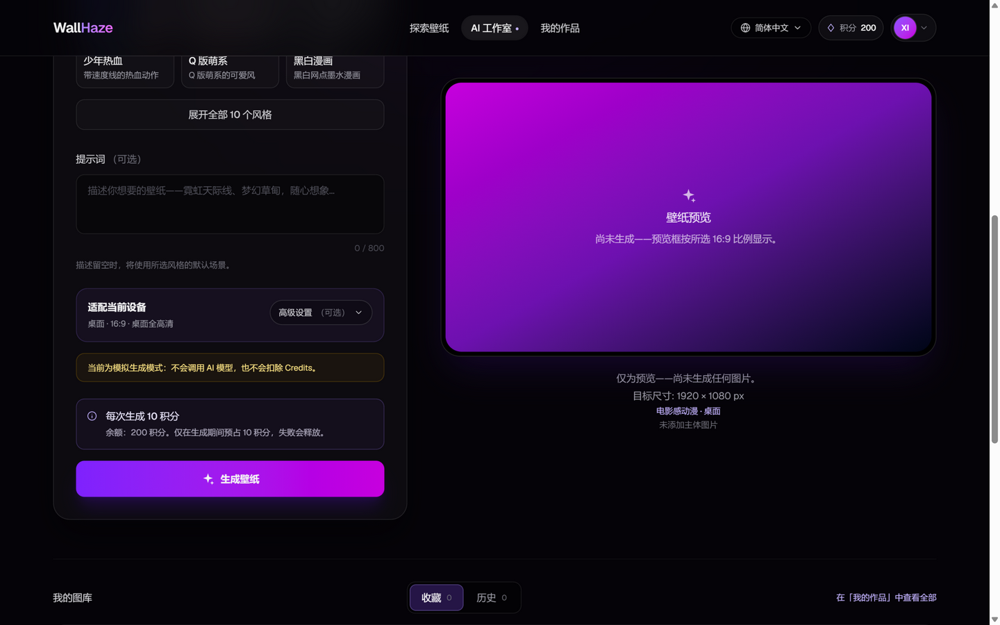

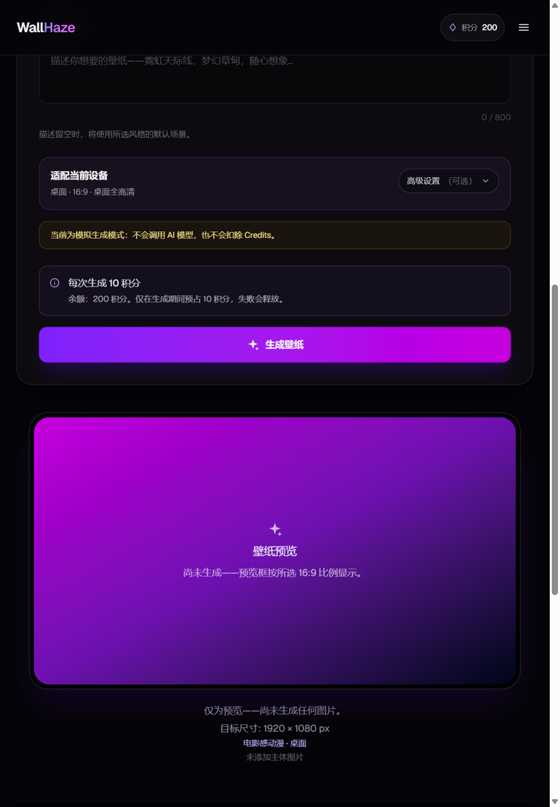

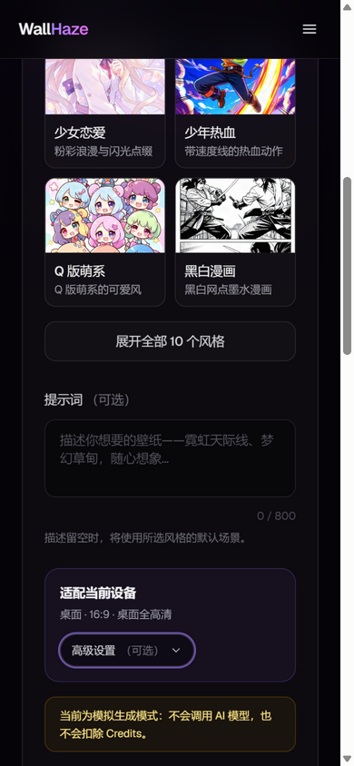

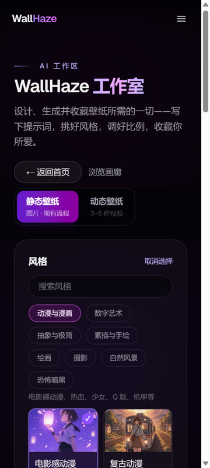

## 11. 修复的动态播放误报

**状态：已真实修复并验证。**

浏览器实测发现：`video.play()` 被中断（例如预览启动时页面被截图表面/隐藏打断）时，旧逻辑把任何 Promise rejection 都当成“视频无法播放”，永久替换播放器。视频本身并无媒体错误。

修复：

- 只有 `video.error` 存在时才设置失败状态；
- `AbortError` / `NotAllowedError` 等中断不会破坏可重试的播放器；
- 新增 2 个 DOM 测试：中断 play 保留播放器；真实 media error 才显示失败提示。

修复后动态演示正常播放并循环回绕，见 §6 的实测状态。

## 12. 测试与构建

**状态：全部通过。**

| 项目 | 结果 |
|---|---|
| Web TypeScript | 通过（`tsc --noEmit`） |
| Web ESLint | 通过（`eslint`，无输出） |
| Web Vitest | **206 passed / 29 files** |
| Web production build | 通过（`next build`，退出码 0） |
| API TypeScript | 通过 |
| API Vitest | **220 passed / 2 skipped / 33 files** |
| Contracts TypeScript | 通过 |

新增/更新的重点测试：

- `tests/media-device.test.ts`：真实比例、原生设备分类、设备优先排序、Provider 比例推荐、39 张静态壁纸尺寸一致性。
- `tests/live-demos.test.ts`：6 个 MP4/Poster 存在、`ftyp`、大小、时长、尺寸、设备、风格。
- `tests/studio-defaults.test.ts`：默认风格有效、空描述可用、无风格仍拒绝。
- `tests/live-video-player.dom.test.ts`：播放中断不误报、真实媒体错误才报错。
- `tests/i18n-parity.test.ts`：7 语言键集合完全一致（新增 detail/gallery/liveStudio/generator 键）。

## 13. 五档浏览器验收

**状态：已完成；真实触摸设备仍需人工复核。**

| 视口 | 页面 | 结果 |
|---|---|---|
| 1440×900 | 详情 / Studio / Gallery | 通过；详情无比例条；Studio 主流程与高级设置正常；Gallery 6 个演示与设备筛选正常 |
| 1280×800 | Gallery | 通过；预览 + 演示列表布局正常，演示卡 6 个 |
| 820×1180 | 详情 / Studio | 通过；820 单列布局无横向溢出；详情真实比例 |
| 390×844 | 详情 / Studio / Gallery | 通过；手机首屏、主流程、媒体切换、播放、平板动态筛选正常 |
| 360×800 | Studio / Gallery | 通过；最窄视口无横向溢出，筛选与生成按钮可用 |

补充证据：

- 详情 820：`screenshots/device-wallpaper/after-detail-820.png`
- 详情 390 信息区：`screenshots/device-wallpaper/after-detail-390-info.png`
- Gallery 1280 初始：`screenshots/device-wallpaper/after-gallery-1280-initial.png`
- Gallery 360：`screenshots/device-wallpaper/after-gallery-360-live.png`

## 14. 23 项要求状态对照

| # | 要求 | 状态 |
|---|---|---|
| 1 | Studio 普通用户五步主流程 | 已真实实现并验证 |
| 2 | 壁纸类型选择 | 已真实实现并验证 |
| 3 | 默认有效风格 | 已真实实现并验证 |
| 4 | 描述可选、可空 | 已真实实现并验证 |
| 5 | 当前设备自动适配 | 已真实实现并验证（真实触摸设备待复核） |
| 6 | 手动覆盖设备 | 已真实实现并验证 |
| 7 | 高级设置默认收起 | 已真实实现并验证 |
| 8 | 收起保留值 | 已真实实现并验证 |
| 9 | 恢复推荐设置 | 已真实实现并验证 |
| 10 | 详情页真实比例、无拉伸/裁切 | 已真实实现并验证（前后截图） |
| 11 | 原图 + 设备模拟预览 | 已真实实现并验证 |
| 12 | 模拟标注不可下载 | 已真实实现并验证 |
| 13 | 6 个真实可播放 5 秒演示 | 已真实实现并验证 |
| 14 | Poster/时长/尺寸/设备/比例/风格 | 已真实实现并验证 |
| 15 | 明确标注演示非 AI | 已真实实现并验证 |
| 16 | Gallery 全部/静态/动态 | 已真实实现并验证 |
| 17 | Gallery 全部/手机/平板/桌面 | 已真实实现并验证 |
| 18 | 自动优先当前设备、不隐藏其他 | 已真实实现并验证（排序逻辑） |
| 19 | Gallery/Studio/详情设备信息 | 已真实实现并验证 |
| 20 | 动态 Provider 比例限制 | 已真实实现并验证（无真实 Provider 调用） |
| 21 | 测试 | 已真实实现并验证（Web 206 / API 220） |
| 22 | 五档浏览器验收 | 已完成 |
| 23 | 真实 AI/付费安全边界 | 未执行真实付费 AI；无 Git/部署 |

## 15. 仍存在的限制与阻塞

**存在阻塞：**

1. **静态 Gallery 没有平板原生文件。** 39 张静态壁纸只有 9:16 手机与 16:9 桌面原生文件；平板筛选为空是真实数据结果，不是 UI bug。要补平板内容，需要新增真实 3:4/1:1 资产（不能靠裁切/补边伪造并称为原生）。
2. **真实手机/平板触摸识别未在真机验证。** IAB 只能改 viewport，不能模拟 `screen.width`、DPR 与 `maxTouchPoints`；纯函数和桌面浏览器已测试，仍需真机复核。
3. **真实 AI 视频/图片 Provider 未调用。** 本轮没有真实付费请求；动态生成仍走既有 Mock/Provider capability 逻辑，真实模型输出、延迟、编码、成本需单独授权测试。
4. **生产对象存储/流式 Range 未接入。** 视频/图片仍为本地实现，生产需 R2/S3、生命周期与多 Worker 验证。
5. **公开动态 Gallery。** 当前 6 个演示是自制演示；用户视频仍私有在 My Creations，不会自动发布。

**未改变的安全边界：**

- 未修改 Google OAuth 绑定规则；
- 未关闭认证、Credits、预算或付费限制；
- 未开启 `FAL_LIVE_ENABLED` / `FAL_VIDEO_LIVE_ENABLED`；
- 未执行真实支付/付费 AI 调用；
- 未执行生产数据库迁移；
- 未执行 Git commit/push、未正式部署。

## 16. 主要文件

- Studio：`apps/web/components/GeneratorSection.tsx`、`components/studio/LiveWallpaperStudio.tsx`、`components/studio/LiveVideoPlayer.tsx`、`lib/studio/defaults.ts`
- Gallery：`components/gallery/GalleryExperience.tsx`、`components/gallery/LiveDemoGallery.tsx`、`components/WallpaperBrowser.tsx`、`components/ui/ImageCard.tsx`、`components/FeaturedWallpapers.tsx`
- 详情：`app/[locale]/wallpapers/[slug]/page.tsx`、`components/media/WallpaperDeviceBadge.tsx`、`components/media/WallpaperDevicePreview.tsx`
- 媒体/设备模型：`lib/media.ts`、`lib/wallpapers.ts`、`lib/live-demos.ts`
- 演示资源：`public/videos/live-demos/*.mp4`、`*.png`
- 测试：`tests/media-device.test.ts`、`tests/live-demos.test.ts`、`tests/studio-defaults.test.ts`、`tests/live-video-player.dom.test.ts`
- 7 语言：`messages/{en,zh,ja,ko,es,fr,de}.json`

## 17. 结论

本轮把 Studio 从“参数面板”收敛成普通用户可理解的主流程，把静态详情页的比例错误从根因修复，并用真实可播放的自制演示填补了动态壁纸的空状态。设备信息现在贯穿 Gallery、Studio 和详情页，且所有“原生/模拟”边界都明确标注。

**可以进入下一轮真实设备与真实 Provider 验证；在取得授权前，不应把 Mock/自制演示描述为真实 AI 输出。**
