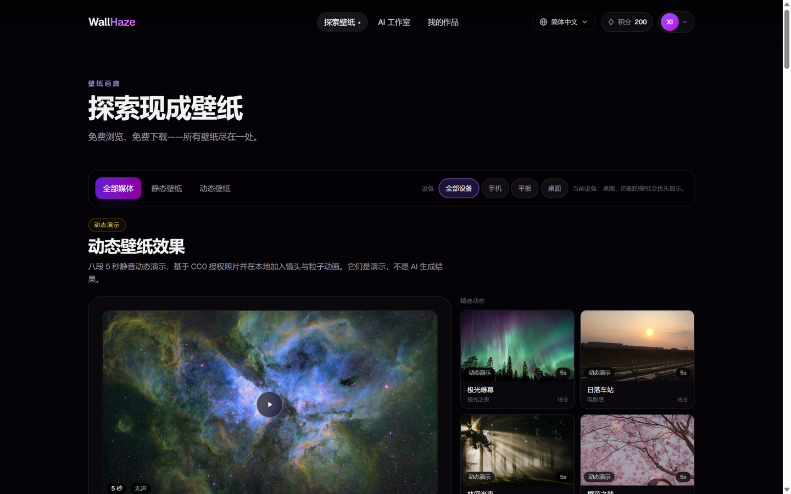
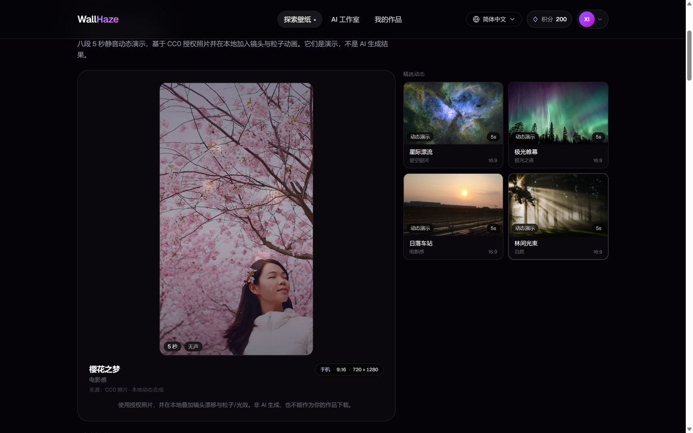
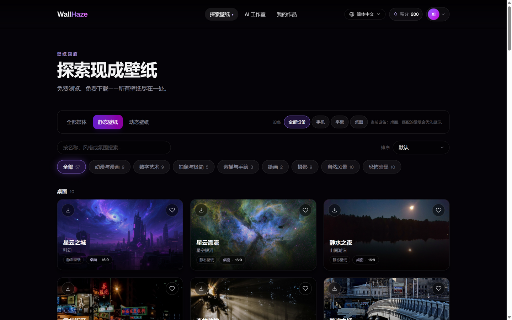
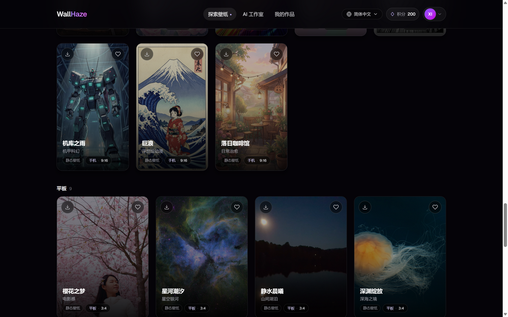
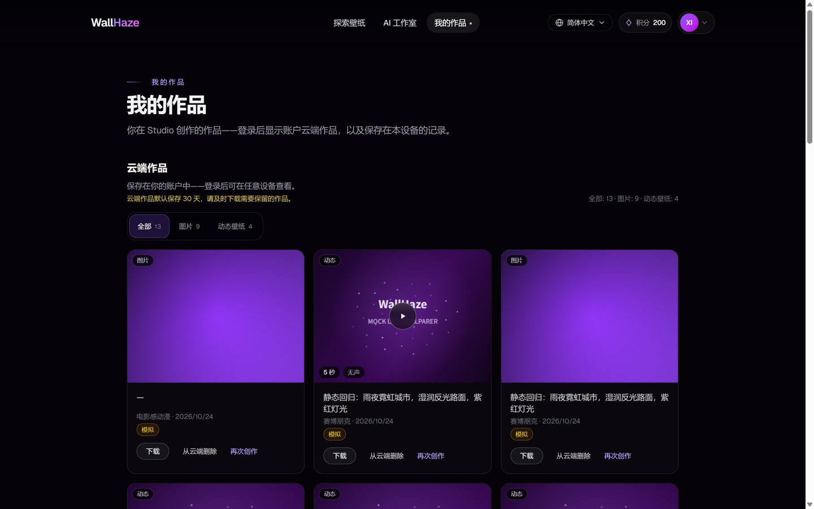

# WallHaze V2.0 动态壁纸质量与 Gallery 专项升级报告

- 日期：2026-10-24
- 范围：`apps/web`、`apps/api`（媒体生命周期）、`packages/contracts`（类型检查）、本地 PGlite
- 结论：**动态演示已从简单几何动画升级为 8 个基于授权照片的真实 5 秒 MP4；30 天云端保留与过期访问控制已实现并有自动化测试；新增 8 个主流风格和 18 张平板/电脑壁纸；Gallery 已重排为紧凑的动态预览区 + 设备分组网格。**
- 最终验收结论：**视频 A=0 / B=8 / C=0**（全部为授权照片 + 本地镜头/粒子合成，不是 AI 视频）；**15 个 CC0 来源、24 个派生输出全部通过 Commons 实时许可复核，0 失败**；**57 张 Gallery 壁纸 = 桌面 10 / 手机 38 / 平板 9**，其中旧 39 张仍为 `review-pending`，未升级、未删除，31 个本地源文件已隔离、8 个外部 URL 已移除引用；**Web 244、API 228 通过 + 1 个显式跳过的 120 秒真实计时器测试、Contracts 通过，Web/API build 与 lint 通过**。
- 上线结论：**Gallery 内容与交互可验收，但生产上线仍未就绪。** 30 天清理保持关闭；生产对象存储（R2/S3）、PostgreSQL 压测、监控告警、真实 AI 视频付费验证、39 张旧素材的逐张授权和真实支付均未完成。未调用真实付费 AI，未启用不可逆删除，未执行 Git commit/push 或正式部署。

## 1. 当前页面问题（审计结论）

- 旧动态精选是“左侧一个渐变大视频 + 右侧六张竖向长列表”，右侧高度过长，造成大面积空白。
- 动态素材是几何线条、渐变、简单月亮/粒子，缺少真实照片的细节和光影，不能作为主推内容。
- 静态 Gallery 全部按近似手机竖屏卡片混合排列，设备差异不可见，行内比例不一致产生破碎空白。
- 没有 3:4 平板或 16:9 电脑原创内容；平板筛选只能是空状态。
- 没有媒体生命周期：生成作品只有软删除，没有服务端 30 天到期、访问拒绝、对象清理和清理记录。
- Style Registry 已有 46 个风格，但缺少星空银河、山间湖泊、深海、极光、极简建筑、微距自然、柔和渐变、抽象光效等主流风格。

## 2. 实际采用的媒体制作方式

**没有调用任何真实 AI 图像/视频模型。** 本轮媒体分两类：

1. **授权照片 + 本地动态合成**：从 Wikimedia Commons 选取 CC0 照片，本地裁切/轻微调色，再由 headless Edge 的 Canvas + MediaRecorder 录制真实 H.264 MP4。动态仅包含：
   - 循环正弦镜头漂移/缩放（起止一致）
   - 雨丝、花瓣、星星、气泡、极光微光、尘埃/树叶、bokeh 粒子
   - 静音、无真实人物重绘、无镜头切换
2. **原创程序化抽象图**：Soft Gradient / Light Ribbons 由本地 Canvas 绘制，标注 `self-authored`，不使用任何第三方素材。

不把纯渐变加移动称为高质量动态壁纸；不把照片 + 本地动画写成 AI 生成。

## 3. 新增动态视频名称与数量

**8 个，全部完成。**

| # | ID | 展示名称 | 尺寸 | 主要设备 | 文件 |
|---|---|---|---|---|---|
| 1 | night-sakura | 樱花之梦 / Sakura Dream | 720×1280 | 手机 | `/videos/live-demos/night-sakura.mp4` |
| 2 | neon-rain | 霓虹雨夜 / Neon Rain | 720×1280 | 手机 | `/videos/live-demos/neon-rain.mp4` |
| 3 | star-drift | 星际漂流 / Star Drift | 1280×720 | 电脑 | `/videos/live-demos/star-drift.mp4` |
| 4 | jellyfish-glow | 深海水母 / Jellyfish Glow | 1024×1024 | 平板 | `/videos/live-demos/jellyfish-glow.mp4` |
| 5 | aurora-veil | 极光帷幕 / Aurora Veil | 1280×720 | 电脑 | `/videos/live-demos/aurora-veil.mp4` |
| 6 | sunset-station | 日落车站 / Sunset Station | 1280×720 | 电脑 | `/videos/live-demos/sunset-station.mp4` |
| 7 | forest-light | 森林微光 / Forest Light | 1280×720 | 电脑 | `/videos/live-demos/forest-light.mp4` |
| 8 | flower-field | 梦幻花海 / Flower Field | 720×1280 | 手机 | `/videos/live-demos/flower-field.mp4` |

### 真实文件数据

| ID | 时长（生成/浏览器） | 编码 | 大小 | Poster |
|---|---|---|---|---|
| night-sakura | 5s / 5s | MP4 · H.264 · 无音频 | 2,178,315 B | `night-sakura.jpg` |
| neon-rain | 5s / 5s | MP4 · H.264 · 无音频 | 2,169,791 B | `neon-rain.jpg` |
| star-drift | 5s / 5s | MP4 · H.264 · 无音频 | 2,160,634 B | `star-drift.jpg` |
| jellyfish-glow | 5s / 5s | MP4 · H.264 · 无音频 | 2,162,177 B | `jellyfish-glow.jpg` |
| aurora-veil | 5s / 5s | MP4 · H.264 · 无音频 | 2,171,419 B | `aurora-veil.jpg` |
| sunset-station | 5s / 5s | MP4 · H.264 · 无音频 | 2,174,507 B | `sunset-station.jpg` |
| forest-light | 5s / 5s | MP4 · H.264 · 无音频 | 2,167,085 B | `forest-light.jpg` |
| flower-field | 5s / 5s | MP4 · H.264 · 无音频 | 2,158,824 B | `flower-field.jpg` |

说明：MediaRecorder 输出的是 fragmented MP4，`mvhd` 时长可能为 null；浏览器读取的实际 `video.duration` 为 5 秒。媒体测试检查 `ftyp`、文件大小、JPEG Poster 头、无 `mp4a` 音轨；浏览器实测 `duration=5`、`loop=true`、`muted=true`、`video.error=null`。

## 3.1 8 条视频逐条质量评审

评级口径：

- **A**：真实主体运动、自然循环、可直接作为精选主推。
- **B**：高质量照片 + 克制的镜头/环境动态，可作为普通演示内容。
- **C**：明显静态、抖动、闪烁、割裂或首尾跳变，不推荐展示。

测量方式：实际播放到 0.05s / 1.25s / 2.45s / 3.65s / 4.9s 抓取原始分辨率帧，计算平均像素差；同时读取浏览器 `duration`。完整帧和 contact sheet 在
`screenshots/gallery-quality-upgrade/video-frames/`。

| ID | 实际时长 | 分辨率 | 动态证据（0→3 帧平均差） | 首尾差 | 评级 | 结论 |
|---|---|---|---|---|---|---|
| night-sakura | 4.987s | 720×1280 | 0.0877 | 0.0201 | B | 樱花照片清晰，镜头漂移 + 花瓣；主要是照片运动，非角色/枝条真实动画 |
| neon-rain | 4.990s | 720×1280 | 0.0583 | 0.0130 | B | 霓虹街景清晰，镜头推进 + 雨/反光；雨丝在缩略帧中偏弱 |
| star-drift | 4.998s | 1280×720 | 0.0335 | 0.0101 | B | 真实星云照片，缓慢漂移 + 星点；不是生成式星云演化 |
| jellyfish-glow | 4.993s | 1024×1024 | 0.0222 | 0.0069 | B | 水母照片 + 气泡/柔光；触手没有真实形变 |
| aurora-veil | 5.005s | 1280×720 | 0.0309 | 0.0099 | B | 极光照片 + 微光；不是极光形态实拍动画 |
| sunset-station | 5.000s | 1280×720 | 0.0233 | 0.0067 | B | 站台夕阳照片 + 树叶/暖光；云层没有真实流动 |
| forest-light | 5.001s | 1280×720 | 0.0254 | 0.0088 | B | 森林光束照片 + 空气尘埃；光束不是真实体积光动画 |
| flower-field | 5.003s | 720×1280 | 0.0845 | 0.0209 | B | 罂粟花照片 + 花瓣/bokeh；植物没有真实摆动 |

**结论：A = 0，B = 8，C = 0。**

- 没有 C 级：无抖动、闪烁、割裂或明显首尾跳变；首尾差均低于相邻帧差，说明周期镜头设计有效。
- 但没有 A 级：8 条都主要依赖整张照片的缓慢平移/缩放 + 局部粒子，不是真正的角色/天气/植被模拟。不能把它们称为“高质量 AI 动画”。
- 处理结果：保留为 **B 级普通 Gallery 演示**，明确标注本地合成 / 非 AI；Gallery 右侧标签已从“精选”改为“动态预览”，避免把 B 级内容包装成 A 级精选。
- 若要达到 A 级主体运动（发丝、雨滴与反射、水母触手、云层、树叶），需要真实 AI 视频或更复杂的授权素材/合成；列入真实 AI 视频制作计划，本轮不发起付费生成。
- `floating-isles` 主题没有交付，未用低质量程序化占位。

## 4. 素材来源与使用依据

完整逐文件记录见 **[MEDIA-SOURCES.md](./MEDIA-SOURCES.md)**。

| 演示 | 源照片 | 作者 | 许可 |
|---|---|---|---|
| Sakura Dream | Cherry blossom against blue sky (Unsplash) | indah nur indaheart | CC0 |
| Neon Rain | Hong Kong in the night | Wilfredor | CC0 |
| Star Drift | Carina Nebula in Hubble Palette | Dylan O'Donnell | CC0 |
| Jellyfish Glow | Lion's mane jellyfish in Gullmarn fjord at Sämstad 3 | W.carter | CC0 |
| Aurora Veil | Polar lights over dark trees (Unsplash) | Vincent Guth | CC0 |
| Sunset Station | Sunset Bruges station | Antonio Borrillo | CC0 |
| Forest Light | Sunrise breaking into the forest (Unsplash) | Kristine Weilert | CC0 |
| Flower Field | Poppy field, Oberauroff, detail | Gerda Arendt | CC0 |

来源页面、原始尺寸、裁切方式、输出尺寸均记录在 `apps/web/scripts/media/photo-manifest.json`。所有 CC0 照片均允许免费使用/修改；没有引入版权不明的第三方图片或视频。

### 4.1 实时许可复核（最终）

- 复核脚本：`apps/web/scripts/media/audit-licenses.mjs`，直接读取 Wikimedia Commons `imageinfo/extmetadata`。
- 覆盖：**15 个来源、24 个派生输出**（8 条视频的来源帧、8 张 Poster 对应的照片、16 张壁纸/风格图去重后的全部输出）。
- 结果：**24/24 `licenseVerified=true`、0 失败、`LicenseShortName=CC0`、`attributionRequired=false`**；检查日期 2026-10-24。
- 结果文件：`apps/web/scripts/media/license-audit.json`；逐文件作者、原始尺寸、裁切锚点、许可证据、取得日期、分发范围、第三方权利说明在 `photo-manifest.json`。
- Commons 的 `Copyrighted=True` 与 CC0 并不冲突：CC0 是权利人主动放弃版权后的公共领域贡献，仍以 `LicenseShortName=CC0` 为授权依据；本项目仍保留作者与来源署名。
- 原先樱花/花海照片中存在可识别人物，缺少可核实的人物授权；已替换为无可识别人物的 CC0 樱花与罂粟花照片，并重新生成静态图和动态演示，避免依赖未经核实的人物 release。
- **已整改的访问控制：** 旧 39 张仍为 `review-pending`，但其 31 个本地风格源文件已从 `public/images/styles/` 移入 `private-media/review-pending/styles/`，原 URL 实测返回 404；另 8 个外部 text-to-image URL 已从导出目录和首页引用中移除。39 张全部不再有可公开取得的原图/远程图引用，也没有被升级为 verified。文件未删除，哈希与可逆映射在 `private-media/review-pending/manifest.json`。详见 [《全站媒体版权合规审计与整改报告》](./COPYRIGHT-COMPLIANCE-REPORT.md)。

**哪些是真实 AI 生成？** 本轮的静态新增、动态演示和风格预览中，**没有任何一个是真实 AI 生成**。动态是授权照片 + 本地合成；两张抽象壁纸是程序化自绘。AI 模型调用保持关闭。

## 5. 作品 30 天保留（实现）

### Schema

新增迁移 `apps/api/migrations/006_media_lifecycle.sql`：

- `image_assets.completed_at`
- `image_assets.expires_at`
- `image_assets.retention_policy`：`legacy` / `temporary_30d`
- `image_assets.storage_status`：`active` / `deleting` / `deleted` / `delete_failed`
- `delete_attempts`, `last_cleanup_error`, `deleted_at`, `updated_at`
- `media_cleanup_runs`（每次扫描的 id、开始/结束、dry_run、scanned/deleted/failed、details）

**安全迁移：** 已有行保留 `retention_policy='legacy'`、`expires_at=NULL`，清理任务永远不会选中它们；不会被自动误删。

### 新作品

`completeJob()` 在媒体成功保存的同一事务中写入：

- `completed_at = now()`
- `expires_at = now() + interval '30 days'`
- `retention_policy='temporary_30d'`
- `storage_status='active'`

到期时间由服务端数据库计算，不依赖用户设备时间。

### 访问控制

- `/v1/creations` 仍返回过期作品的最小记录，但 `imageUrl/videoUrl/posterUrl` 为 null，`expired=true`，`retentionStatus='expired'`。
- `/v1/creations/:id/image|video|poster|download` 对过期/删除中的资源返回 404，即使签名 URL 本身尚未到期。
- 签名 URL 只能用于 active 且未过期的对象。
- Studio 成功结果和 My Creations 显示通知；My Creations 卡片显示剩余天数、到期日期或“已过期 — 云端文件已清理”。

### 清理任务

`apps/api/src/business/media-lifecycle.ts`：

- 仅扫描 `retention_policy='temporary_30d' AND expires_at <= now()`；
- 只处理 `active/deleting/delete_failed` 且未超过重试次数（默认 3）的行；
- 先标记 `deleting` 再用 `FOR UPDATE SKIP LOCKED` 领取；`deleting` 只有超过 10 分钟才视为崩溃遗留并重试，`delete_failed` 有 30 秒退避，避免并发重复删除；
- 删除 Poster → 主视频/图片；删除成功标记 `deleted`，失败标记 `delete_failed` 并记录错误，下一轮重试；
- 再次运行不会重复删除（幂等）；崩溃后 `deleting` 行会在下一轮安全重试；
- 每次运行写入 `media_cleanup_runs`；
- 上传的参考图不是独立对象文件，任务成功/失败结算时立即从 job request 中移除（`request - 'refImage' - '_sourceImageDataUri'`），早于 24 小时要求；
- 财务 Ledger、支付订单、官方 Gallery 文件不在清理范围。

## 6. 是否实际启用了删除？

**否。** 这是本轮最重要的安全边界：

- `cleanupExpiredMedia` 默认 `dryRun: true`。
- `npm run ops` 默认只做扫描并记录，除非同时满足：
  - `MEDIA_RETENTION_CLEANUP_ENABLED=1`
  - `STORAGE_DIR` 指向真实对象目录
- 未对现有作品执行任何删除。
- 正式启用前仍需要确认 R2/S3 Lifecycle、备份、恢复演练和删除窗口。

## 7. 新增主流风格（8 个）

| Style ID | 名称 | 分类 | 预览来源 | 静态 Prompt / Motion |
|---|---|---|---|---|
| `starry-galaxy` | 星空银河 / Starry Galaxy | Nature | CC0 Carina 星云 | 深空星云、星场、尘埃；motion 为星点闪烁/星云漂移 |
| `mountain-lake` | 山间湖泊 / Mountain Lake | Nature | CC0 月光山湖 | 蓝调时刻、镜面倒影、林脊；motion 为水波/薄雾 |
| `deep-ocean` | 深海之境 / Deep Ocean | Nature | CC0 狮鬃水母 | 深海体积光、水母触手、悬浮颗粒；motion 为水母脉动/气泡 |
| `aurora-nights` | 极光之夜 / Aurora Nights | Nature | CC0 极光 | 绿紫极光、雪地/峡湾、星空；motion 为极光帘幕 |
| `architecture-minimal` | 极简建筑 / Architecture Minimal | Photography | CC0 极简室内 | 几何体块、柔和日光、留白；motion 为光影缓慢移动 |
| `macro-nature` | 微距自然 / Macro Nature | Photography | CC0 露珠叶片 | 露珠、叶脉、浅景深；motion 为露光/叶片轻摆 |
| `soft-gradient` | 柔和渐变 / Soft Gradient | Abstract | 自绘程序化 | 半透明色场、柔和光晕、细颗粒；motion 为慢速色彩流动 |
| `abstract-light` | 抽象光效 / Abstract Light | Digital | 自绘程序化 | 棱彩光带、深色底、bloom；motion 为光带漂移 |

新增风格已进入静态 Prompt Builder、视频 Prompt Builder 和 `style-motion`；七语言名称/描述均存在。没有删除任何旧 Style ID；历史作品恢复参数不受影响。

## 8. 新增平板/电脑壁纸

- **平板原生 3:4：9 张**（1080×1440）
- **电脑原生 16:9：9 张**（1920×1080）
- **手机：新增 0 张**；原有手机竖屏内容完整保留，不重复填充。
- 总计新增 **18 张**，Gallery 从 39 张变为 **57 张**。
- 其中 **16 张**是 CC0 授权照片（标注 `verified` 并有 source/author/license），**2 张**是自绘抽象（`self-authored`）。
- 每张下载的是实际裁切后的原始输出，不是拉伸/补边的假变体；来源、原始尺寸、裁切锚点和输出尺寸记录在 `photo-manifest.json`。

示例：

- 平板：Sakura Dream、Galaxy Tide、Stillwater Dawn、Abyssal Bloom、Aurora Veil、Quiet Geometry、Dewline、Poppy Field、Soft Horizon。
- 电脑：Nebula Drift、Stillwater Night、Neon District、Forest Cathedral、Quiet Bridge、Jellyfish Deep、Sunset Platform、Aurora Veil Wide、Light Ribbons。

原有 39 张仍为 `review-pending`，没有被提升为“已验证/可商用”；新增 CC0 照片的详情页显示来源与许可，标题使用 `Free Wallpaper`，不再统称 `Free AI Wallpaper`。

## 9. Gallery 改造结构

### 顶部

- 页面标题 + 媒体类型（全部/静态/动态）+ 设备（全部/手机/平板/桌面）统一在一个紧凑工具栏。
- 搜索、排序、分类、风格筛选保留在静态区；不再在动态和静态各自重复一套设备按钮。

### 动态预览

- 桌面：左侧 1 个主预览视频，右侧 2×2 推荐卡片；其余示例在下方 3 列网格。
- 平板：单列主视频 + 2×2 推荐区。
- 手机：单列主视频 + 横向可滑动推荐；不再堆一条超长竖向列表。
- 同一时刻只有一个 `<video>`；点击卡片切换主预览；播放静音、循环、playsInline、用户触发，尊重 reduced-motion。

### 静态网格

- 按真实原生设备分组：电脑 3 列、平板 4 列、手机 5 列（1440 视口）。
- 卡片按实际宽高比显示（桌面 16:9、平板 3:4、手机 9:16），不统一裁成手机竖屏。
- 作品只保留标题、风格、设备、比例、静态/动态类型、收藏与下载；不再堆叠过多 Badge。
- `All devices` 只排序、不隐藏；选择具体设备才过滤。

### 改造前/后

改造前（上一轮）：[旧 Gallery 竖向动态列表](screenshots/device-wallpaper/after-gallery-1440-live-final.png)

改造后（本轮）：[新 Gallery 动态区](screenshots/gallery-quality-upgrade/after-gallery-1440-live.png)

切换樱花主视频：

静态设备分组（电脑）：

平板组：

## 10. 30 天前端体验

- My Creations 云端区域显示：“新生成的云端作品默认保存 30 天，请及时下载需要保留的作品。”
- 新作品卡片显示“剩余 N 天 · 到期日期”；≤7 天变为琥珀色，≤1 天为紧急色；过期显示“已过期 — 云端文件已清理”，不提供下载。
- Studio 成功结果区域显示“云端保存：本次新作品默认保留 30 天，请在到期前下载。”
- 旧作品是 legacy，不显示倒计时，也不会被清理。
- 没有为了截图而向用户账户写入测试作品；倒计时/过期状态由纯函数测试 + API 生命周期测试覆盖。

## 11. 测试与构建

| 项目 | 结果 |
|---|---|
| Web TypeScript | 通过 |
| Web ESLint | 通过（无输出） |
| Web Vitest | **244 passed / 34 files** |
| Web build | 通过（退出码 0） |
| API TypeScript | 通过 |
| API build | 通过 |
| API Vitest | **228 passed / 1 skipped / 34 files** |
| Contracts typecheck | 通过 |

**关于 2 个 skipped：** 上一轮统计的 2 个 skipped 中，有 1 个是测试组织缺陷——`GEN-27` 的 120 秒真实计时器测试把同 `describe` 内的“同步生图接口拒绝视频参数”用例一起跳过了。已把后者移出并恢复执行，新增 `app.close()` 清理，因此本轮 API 从 `225 passed + 2 skipped` 变为 **`228 passed + 1 skipped`**。剩余 1 个是显式 opt-in 的 `GEN-27`：只有设置 `RUN_S2_REAL_120S=1` 才运行约 125 秒，默认跳过；它不产生外部费用，超时错误映射路径已由 `GEN-09` 用模拟 AbortError 覆盖。影响仅是默认 CI 不跑真实 120 秒计时器，不影响生产代码的该分支正确性。

新增/更新的重点测试：

- `tests/media-lifecycle.test.ts`：30 天精确间隔、过期列表/签名 URL/download 拒绝、dry-run 不删除、实际清理、幂等、失败重试、崩溃后 `deleting` 恢复、并发两轮只删除一次、legacy 保护、ledger 行不变。
- `apps/web/tests/retention.test.ts`：剩余天数、7/1 天阈值、过期、legacy 无日期。
- `apps/web/tests/live-demos.test.ts`：8 个 MP4、Poster、`ftyp`、文件大小、无 `mp4a` 音轨、原生设备、真实风格。
- `apps/web/tests/gallery-assets.test.ts`：18 张新壁纸的本地文件、真实比例、来源/verification/self-authored、9 平板 + 9 电脑。
- `apps/web/tests/media-device.test.ts`：57 张壁纸尺寸一致性、设备分类、设备排序、Provider 比例推荐。
- `apps/api/tests/styles-catalog.test.ts`：新增 8 个风格的模板、视觉元数据、motion 元数据。
- `i18n-parity.test.ts`：七语言 key 完全一致。

## 12. 浏览器验收（五档）

| 视口 | 页面/检查 | 结果 |
|---|---|---|
| 1440×900 | Gallery 顶部/动态区/桌面静态分组；动态播放；详情页 | 通过 |
| 1280×800 | Gallery 顶部、动态预览、桌面分组 | 通过 |
| 820×1180 | 移动导航、单列主视频、桌面组 2 列 | 通过 |
| 390×844 | 手机顶部、全部动态横向条、静态组 1 列、详情状态 | 通过 |
| 360×800 | 最窄视口无横向溢出；工具栏/设备筛选/横向条可用 | 通过 |

**真实前后对比（同为 1440 宽）：**

- 改造前（旧实现）：[旧动态区为空 + “所有壁纸免费下载”文案](screenshots/gallery-live-1440.png)
- 改造后（最终）：[新动态主预览 + 2×2 + 设备工具栏](screenshots/gallery-quality-upgrade/final/gallery-1440-top.png)
- 改造前详情：[审核中仍显示下载按钮](screenshots/device-wallpaper/before-detail-1440.png)
- 改造后详情：[审核中无下载按钮，明确“暂不提供下载”](screenshots/gallery-quality-upgrade/final/detail-pending-1440.png)

**最终关键截图：**

- [1440 Gallery 首屏](screenshots/gallery-quality-upgrade/final/gallery-1440-top.png)
- [1440 桌面静态分组](screenshots/gallery-quality-upgrade/final/gallery-1440-static-desktop.png)
- [1280 首屏](screenshots/gallery-quality-upgrade/final/gallery-1280-top.png) / [1280 桌面组](screenshots/gallery-quality-upgrade/final/gallery-1280-static-desktop.png)
- [820 首屏](screenshots/gallery-quality-upgrade/final/gallery-820-top.png) / [820 桌面组](screenshots/gallery-quality-upgrade/final/gallery-820-static-desktop.png)
- [390 首屏](screenshots/gallery-quality-upgrade/final/gallery-390-top.png) / [390 动态横向条](screenshots/gallery-quality-upgrade/final/gallery-390-live-strip.png) / [390 桌面组](screenshots/gallery-quality-upgrade/final/gallery-390-static-desktop.png)
- [360 首屏](screenshots/gallery-quality-upgrade/final/gallery-360-top.png) / [360 动态横向条](screenshots/gallery-quality-upgrade/final/gallery-360-live-strip.png) / [360 桌面组](screenshots/gallery-quality-upgrade/final/gallery-360-static-desktop.png)
- [1440 审核中详情](screenshots/gallery-quality-upgrade/final/detail-pending-1440.png) / [390 审核中状态](screenshots/gallery-quality-upgrade/final/detail-pending-390-status.png)
- [1440 已核实详情](screenshots/gallery-quality-upgrade/final/detail-verified-1440.png) / [390 已核实状态](screenshots/gallery-quality-upgrade/final/detail-verified-390-status.png)
- [My Creations 30 天政策](screenshots/gallery-quality-upgrade/after-my-creations-policy-1440.png)
- [动态视频 5 帧 contact sheet](screenshots/gallery-quality-upgrade/video-frames/contact.jpg)

浏览器实测动态：`src=star-drift.mp4`、`duration=4.998`、`loop=true`、`muted=true`、`paused=false`、`video.error=null`、`videos=1`。详情页实测：`sakura-nights` 为 **768×1368 · 9:16**（审核中，无下载）；`sakura-dream` 为 **1080×1440 · 3:4**（已核实，可下载），页面明确写明“下载的是原始文件，不裁切、不补边、不放大”。“在你的设备上看看”区域标注“仅效果预览”，不会把 CSS 设备框当成可下载的适配文件。

## 13. 22 项验收对照

| # | 要求 | 状态 |
|---|---|---|
| 1 | 当前页面问题审计 | 已完成 |
| 2 | 实际媒体制作方式 | 已完成（CC0 照片 + 本地合成；非 AI） |
| 3 | 新增动态名称/数量 | 8 个完成 |
| 4 | 视频实际路径 | 完成 |
| 5 | 时长/分辨率/编码/大小 | 完成（浏览器 5s；H.264；~2.1MB） |
| 6 | 版权/使用依据 | 完成（CC0 + 逐文件记录） |
| 7 | 真实 AI vs 本地演示区分 | 明确：本轮全部非 AI |
| 8 | 30 天保留 | 完成（迁移 + 服务端计算） |
| 9 | 通知与清理规则 | 完成（7/1 天，dry-run 默认） |
| 10 | 是否实际启用删除 | **未启用** |
| 11 | 新增风格 | 8 个 |
| 12 | Prompt/Motion | 完成 |
| 13 | 平板/电脑壁纸数量 | 9 + 9 = 18 |
| 14 | Gallery 前后结构 | 完成 |
| 15 | 动态预览区 | 完成 |
| 16 | 静态网格 | 完成 |
| 17 | 修改文件 | 见下 |
| 18 | 七语言 | 完成，key 对齐 |
| 19 | TS/Lint/Tests/Build | 全部通过 |
| 20 | 桌面/平板/手机截图 | 5 视口完成 |
| 21 | 未完成/阻塞 | 见下 |
| 22 | 原有功能回归 | 见下 |

## 14. 主要代码文件

- 动态演示与媒体：`apps/web/lib/live-demos.ts`、`components/gallery/LiveDemoGallery.tsx`、`components/studio/LiveVideoPlayer.tsx`、`components/studio/LiveWallpaperStudio.tsx`
- Gallery：`components/gallery/GalleryExperience.tsx`、`components/WallpaperBrowser.tsx`、`components/ui/ImageCard.tsx`
- 详情：`app/[locale]/wallpapers/[slug]/page.tsx`
- 静态内容与风格：`lib/wallpapers.ts`、`lib/styles.ts`、`apps/api/src/catalog/styles.ts`、`style-meta.ts`、`style-motion.ts`
- 生命周期：`migrations/006_media_lifecycle.sql`、`apps/api/src/business/jobs.ts`、`media-lifecycle.ts`、`routes.ts`、`ops.ts`、`config/env.ts`
- 前端生命周期：`lib/retention.ts`、`components/creations/CloudCreations.tsx`、`GeneratorSection.tsx`
- 测试：`apps/api/tests/media-lifecycle.test.ts`、`apps/web/tests/{retention,gallery-assets,live-demos,media-device}.test.ts`
- 媒体工具：`apps/web/scripts/media/{cdp.mjs,page-runtime.js,prepare-photos.py,generate-photo-demos.mjs,generate-abstract-stills.mjs}`

## 15. 七语言

新增/更新：
- 8 个风格名称 + 描述
- 18 张壁纸标题 + alt
- 8 个动态演示标题 + alt
- 动态区文案、30 天政策、过期提示、来源标签

`messages/{en,zh,ja,ko,es,fr,de}.json`；`i18n-parity` 通过。所有新增键均为七语言真实翻译，不是只补英文。

## 16. 未完成事项与阻塞

1. **魔法浮岛 / Floating Islands 未交付。** 没有找到可用的授权高质量素材；为避免用低质量程序化图形冒充成品，本轮用 Aurora Veil 替代，并明确记录该主题需要真实 AI 视频或新授权素材。
2. **校园日常 / 四季风景预览未新增。** 没有可信的授权动漫/校园预览；没有把无关照片标成这些风格。现有 `cozy-anime`、`anime-fantasy`、`nature` 等相近风格保留。
3. **真实 AI 未调用。** 所有动态都是 CC0 照片 + 本地动画；没有 fal.ai 付费调用，也没有真实 AI 生成视频。
4. **30 天清理未启用。** 默认 dry-run；生产需要 R2/S3 Lifecycle、备份与恢复演练、删除窗口确认。测试使用内存数据库，不触碰现有作品。
5. **生产对象存储/Range。** 本地仍是 LocalStorage；生产需要 R2/S3、流式 Range、生命周期策略和多 Worker PostgreSQL 验证。
6. **旧 39 张 Gallery 授权仍待逐张审核。** 新增 16 张 CC0 照片已核实；2 张抽象为自绘。没有把旧素材提升为 verified。

## 17. 原有功能回归

- Auth、Google OAuth 绑定规则、Credits 钱包、支付、预算没有修改。
- 静态/动态 Studio、异步 Job/Worker、私有签名 URL、My Creations 删除/再次创作逻辑保留。
- 旧 `image_assets` 行迁移为 legacy；没有纳入清理，不会被自动删除。
- 原有 39 张静态壁纸继续按 review-pending 展示。
- API 全量 **228 passed + 1 显式跳过**；Web **244 passed**；Contracts typecheck、Web/API build、Web lint 全部通过。
- 未执行真实 AI、真实支付、数据库生产迁移、Git 写入或部署。

**结论：动态内容与 Gallery 的视觉质量已达到可展示水平；30 天保留的安全实现和测试已完成，但正式删除任务保持关闭，等待单独授权。**

## 18. 许可复核与下载限制（最终审计）

### 18.1 资产许可状态

| 类别 | 数量 | 状态 | 下载 |
|---|---:|---|---|
| 旧 Gallery 静态作品 | 39 | `review-pending` | **禁止**；31 个本地文件已隔离（原 URL 404），8 个外部 URL 已移除引用 |
| 新增 CC0 照片 | 16 | `verified`，Commons 实时复核通过 | 允许 |
| 自绘抽象 | 2 | `self-authored` | 允许 |
| 动态演示 | 8 | CC0 照片 + 本地合成，非 AI | 仅在线播放；不提供“作为你的作品下载” |

- 15 个来源、24 个输出全部为 CC0，`licenseVerified=true`，0 失败。
- 旧 39 张 = 31 个本地风格源文件 + 8 个外部生成 URL；31 个本地文件已移入 `private-media/review-pending/`，8 个外部 URL 已从导出目录移除。没有把任何一张自动升级为 `verified`，没有删除任何文件。
- 有可识别人物的 Sakura / Poppy 旧照片已替换为无可识别人物的 CC0 素材，相关静态图、视频、Poster、alt 和来源元数据同步更新。
- 详情页对 verified 显示来源、作者、CC0；对 pending 显示“授权审核中，暂不提供下载”，并在按钮位置给出说明。
- 下载门禁：`isDownloadAllowed(license)` 只允许 `verified` 与 `self-authored`；Gallery 卡片、详情页、收藏下载入口统一使用该判断。
- 七语言公开文案已统一为“免费浏览；仅授权已核实的作品可下载”，不再出现“所有壁纸免费下载”。

### 18.2 仍存在的许可/分发风险

1. 旧 39 张是 `review-pending`，不是已清除版权；公开可浏览不等于可商用。
2. 31 个本地 pending 文件已不在 `public/`，原 URL 与 `/_next/image` 代理均返回 404；8 个外部 AI URL 仍存在于第三方服务，但已从本站移除引用，本站无法删除外部副本。生产 CDN/反向代理若缓存过旧 URL，仍需单独 purge。
3. CC0 只解决版权，不解决商标、肖像、建筑外观等第三方权利；已在 manifest 记录 `thirdPartyRights`，但逐张商用审查仍需人工完成。
4. 动态演示是“照片 + 本地合成”，不是 AI 生成；不能作为“AI 视频能力已验收”的证据。

## 19. 设备与比例一致性

| 设备组（1440 视口） | 卡片数 | 组成 | 桌面列数 |
|---|---:|---|---:|
| 桌面 | 10 | 8 张 CC0 16:9 + 1 张自绘 16:9 + 1 张旧 16:9（pending） | 3 |
| 平板 | 9 | 8 张 CC0 3:4 + 1 张自绘 3:4 | 4 |
| 手机 | 38 | 全部旧 9:16（pending） | 5 |

- 总计 **57**：10 + 38 + 9；与 Gallery 页面 H3 分组计数一致。
- 新增 18 张的实际输出：平板 1080×1440（3:4），桌面 1920×1080（16:9）；没有用 CSS 裁剪冒充导出，也没有把 720p 标成 2K。
- 详情页显示实际文件尺寸；`sakura-nights` 实测 768×1368 · 9:16，`sakura-dream` 实测 1080×1440 · 3:4。
- “在你的设备上看看”是 CSS 设备框预览，页面明确写“仅效果预览 / 不是可单独下载的适配文件”。
- `All devices` 只排序不隐藏；选择具体设备才过滤；移动端按原生比例单列显示。

## 20. Gallery 布局与加载性能

### 20.1 布局

- 顶部：媒体类型（全部/静态/动态）+ 设备（全部/手机/平板/桌面）统一在一个工具栏；搜索、排序、分类、风格筛选保留在静态区。
- 动态区：桌面 1 个主预览 + 2×2 推荐 + 其余 3 列；820 单列主视频 + 2×2；390/360 单列主视频 + 全部动态横向 snap 条。
- 静态区：按原生设备分组，1440 下桌面 3 列、平板 4 列、手机 5 列；820 下 2 列；390/360 下 1 列。
- 同一时刻只渲染一个 `<video>`，避免多解码器同时运行；切换卡片替换主播放器源。

### 20.2 视频加载

- 8 条 MP4 单条 **2.06–2.08MB**，总计约 **16.6MB**；但初始只加载 Poster，不加载视频。
- `preload="none"`，用户点击播放后才请求 MP4；浏览器实测初始 `videoRequests=0`、`videoKB=0`。
- 播放实测：`duration=4.998`、`loop=true`、`muted=true`、`video.error=null`、`videos=1`。
- Poster 为静态 JPEG，失败时回退渐变；播放失败显示可读错误，不伪装成成功。

### 20.3 仍可优化的静态图片

- 静态图使用原生 ``，没有 `srcset`/AVIF/WebP；桌面组前 4 张为 eager。
- 资源体量：`public/images/styles` 现为 **2.0MB/8 文件**（31 个 pending 约 17MB 已移入私有隔离区），`public/images/wallpapers` 约 **5.4MB/11 文件**；单张最大约 920KB。
- 首屏不会加载全部 57 张（lazy），但前 4 张 eager 仍可能带来约 1.5MB 级图片请求；上线前建议生成多尺寸 WebP/AVIF + `srcset`，或接入 `next/image` 的本地优化。
- 本轮未改图片管线，避免扩大范围；作为性能优化项保留。

## 21. 30 天生命周期：隔离测试与生产删除阻断

### 21.1 已实现

- 迁移 `006_media_lifecycle.sql`：`completed_at`、`expires_at`、`retention_policy`、`storage_status`、`delete_attempts`、`deleted_at`、`media_cleanup_runs`。
- 新作品完成时由数据库写入 `now()` 与 `now()+30 days`，不依赖客户端时间。
- 过期/删除中/删除失败：列表隐藏签名 URL；`/image|video|poster|download` 返回 404；签名 URL 只对 active 且未过期对象有效。
- 清理只扫描 `temporary_30d`；legacy 永不选中；`deleting` 10 分钟 stale 重试、`delete_failed` 30 秒退避；Poster → 主文件；幂等；并发双跑只删一次；每次运行写 ledger。
- 参考图在 job 成功/失败结算时从 request 中移除，不进入 30 天媒体清理范围。

### 21.2 隔离测试（6/6 通过）

`apps/api/tests/media-lifecycle.test.ts` 使用 **内存数据库 + MemoryStorage**，不连接用户现有数据库/文件：

1. 新资产 `completedAt/expiresAt` 精确相差 30 天；
2. 过期后列表隐藏、签名媒体与下载拒绝，清理幂等；
3. 删除失败下一轮重试；
4. 对象已删但 DB 停在 `deleting` 时崩溃恢复；
5. 两轮清理并发只删除一次；
6. 永不选中 legacy 或官方资产。

测试文件 1 个、6 tests，全部通过；未对真实用户作品执行清理。

### 21.3 生产删除仍被阻断

- 本地 `.env` **未设置** `MEDIA_RETENTION_CLEANUP_ENABLED`（关闭；代码默认 dry-run），`FAL_VIDEO_LIVE_ENABLED` 与 `FAL_LIVE_ENABLED` 也未设置。
- 生产启用前必须完成：R2/S3 对象存储适配器、生命周期/版本/备份策略、恢复演练、staging dry-run 报告、`delete_failed` 监控告警、客服/法务保留策略、删除窗口审批。
- 当前 `LocalStorage` 是 JSON+base64 文件，不支持 Range/分片/对象版本；不能作为生产对象存储。
- 清理 ledger 已有，但没有管理后台/告警面板；上线前需要运维可观测性。

## 22. 基础设施就绪度

| 能力 | 当前实现 | 状态 | 生产缺口 |
|---|---|---|---|
| Gallery/详情 UI | 本地静态数据 + Next.js | 已实现、五视口验收 | 无 |
| 许可审计 | Commons extmetadata 实时脚本 + 82 项资产 registry | 24/24 CC0 通过；31 张已隔离 | 旧 39 张仍需逐张人工授权复核 |
| 数据库 | PGlite（本地单进程）+ PostgreSQL adapter | 本地测试通过 | PostgreSQL 压测、连接池、迁移回滚演练 |
| Worker | 独立 `worker.ts`；lease/fencing/幂等 | 测试通过 | 多实例部署、队列监控、告警 |
| 对象存储 | MemoryStorage / LocalStorage | 本地可用 | **R2/S3 adapter、Range、版本、生命周期** |
| 30 天清理 | dry-run 默认；显式 flag + STORAGE_DIR 才删除 | 隔离测试 6/6 | **生产删除未启用** |
| 视频 AI | mock provider；live gate 关闭 | 仅 mock | 真实模型合同、付费试点、内容安全 |
| 支付/额度 | 既有 wallet/credits/支付代码 | 本轮未改 | 真实支付未执行；上线前单独验收 |
| 监控/告警 | 无 | 缺失 | 生成失败、删除失败、预算、队列积压 |
| CDN/图片优化 | 本地 public 静态文件 | 可用但未优化 | WebP/AVIF、srcset、CDN |

**判定：** 本地/隔离层面“已实现 + 已测试”；生产云层面“未就绪”。不能用本地 PGlite + LocalStorage 的通过结果宣称生产可删除、可扩展。

## 23. 动态视频商业化、成本与 Credits

### 23.1 当前定价（代码事实）

| 模式 | 时长 | Credits | 预留成本上限 | Provider 列表价（2026-10-24 核对） |
|---|---:|---:|---:|---:|
| Wan 2.2-5B I2V | 5s | 40 | $0.50 | $0.15/条 |
| Kling v3 Standard T2V | 3s | 40 | $0.50 | $0.084/s ≈ $0.252 |
| Kling v3 Standard T2V | 4s | 50 | $0.65 | ≈ $0.336 |
| Kling v3 Standard T2V | 5s | 60 | $0.80 | ≈ $0.42 |
| 静态图片 | — | 10 | $4.00 | 未在本轮实测 |

- 视频统一 720p 级别、无音频、9:16/16:9/1:1；I2V 仅 5s，T2V 3/4/5s。
- 以上为 provider 文档/价格注释核对值，不是实际账单；启用前必须以 fal.ai 实时报价和一次受控试点确认。

### 23.2 Credits 收入与毛利（未扣支付/存储/失败重试）

套餐：Starter 100 Credits / $5；Creator 500 / $20；Studio 2000 / $69。按 Studio 套餐（最低单 Credits 收入，$0.0345/Credit）估算：

| 视频 | Credits | Studio 收入 | Provider 成本 | 毛差 | 毛利率 |
|---|---:|---:|---:|---:|---:|
| Wan I2V 5s | 40 | $1.38 | $0.15 | $1.23 | ≈89% |
| Kling T2V 3s | 40 | $1.38 | $0.252 | $1.13 | ≈82% |
| Kling T2V 4s | 50 | $1.73 | $0.336 | $1.39 | ≈81% |
| Kling T2V 5s | 60 | $2.07 | $0.42 | $1.65 | ≈80% |

- 这是**毛利**，未扣支付通道费、退款、内容审核、存储/流量、失败重试和税费；不能当作净利。
- 成本上限（$0.50/$0.65/$0.80）约为列表价的 2.4–3.3 倍，用于预算预留和失败保护；平台/用户日预算应基于上限，不应基于列表价。
- 本地 `.env` 的 `USER_DAILY_COST_LIMIT_MICROS`、`PLATFORM_DAILY_COST_LIMIT_MICROS` **未设置**；FAL 为 mock，所以本地无实际支出。生产启用真实 AI 前必须设置两层上限。
- 存储不是主成本：单条 5s 约 2.07MB，1,000 条约 2.1GB；30 天保留下的对象存储成本远低于生成成本。真正的风险是重试、滥用、失败仍计费和带宽。

### 23.3 从 B 级到 A 级的真实 AI 视频计划（未执行）

- 目标：8 条 5s、720p、无音频的主推视频，要求主体运动（花瓣/雨/水母触手/云层/树叶）而非整图平移。
- 最小付费试点：8 条 Wan I2V 约 **$1.20 provider 成本 / 320 Credits**；或 8 条 Kling 5s 约 **$3.36 / 480 Credits**。以成本上限计分别约 $4.00 / $6.40。
- 必须书面批准后执行；本轮**没有调用**任何真实付费模型。
- 验收门槛：无闪烁、无首尾跳变、主体运动真实、内容安全、授权清晰、失败可重试；未达标则继续保留 B 级照片演示，不冒充 A 级。

## 24. 最终测试、截图与上线结论

### 24.1 测试与构建

| 项目 | 结果 |
|---|---|
| Web TypeScript | 通过 |
| Web ESLint | 通过 |
| Web Vitest | **244 passed / 34 files** |
| Web production build | 通过 |
| API TypeScript | 通过 |
| API build | 通过 |
| API Vitest | **228 passed / 1 skipped / 34 files** |
| Contracts typecheck | 通过 |
| 30 天生命周期定向测试 | **6 passed** |
| 真实付费 AI | **未调用** |
| 真实支付 | **未执行** |
| 生产清理 | **未启用** |
| Git commit/push | **未执行** |
| 正式部署 | **未执行** |

### 24.2 最终 16 项验收

| # | 验收项 | 结论 |
|---:|---|---|
| 1 | 原有成果/并行工作保护 | 未访问受保护目录；未覆盖未提交工作；未 Git 写入 |
| 2 | 8 条视频逐条 A/B/C | **A=0，B=8，C=0** |
| 3 | 视频真实文件 | 4.987–5.005s；720p/1024/720×1280；2.06–2.08MB；H.264 无音频 |
| 4 | 许可审计 | 15 来源 / 24 输出全部 CC0，0 失败 |
| 5 | 下载限制 | 旧 39 张无图/无下载；31 个原 URL 404，8 个外部 URL 已移除引用；18 张 cleared 可浏览/下载 |
| 6 | 设备/比例 | 57 = 桌面 10 / 手机 38 / 平板 9；真实 3:4、16:9、9:16 |
| 7 | Gallery 布局 | 统一工具栏；主视频 + 2×2 + 横向条；设备分组 |
| 8 | 视频加载性能 | 单 `<video>`；preload none；点击前 0 视频字节 |
| 9 | 30 天生命周期 | 隔离测试 6/6；过期拒绝、幂等、重试、并发、legacy 保护 |
| 10 | 生产删除 | **关闭**；flag 未设置；未触碰用户作品 |
| 11 | PostgreSQL 就绪 | adapter 有；本地 PGlite 通过；生产未压测 |
| 12 | R2/S3 就绪 | **缺失**；LocalStorage 不能生产 |
| 13 | 动态成本 | Wan $0.15/5s；Kling $0.252/$0.336/$0.42 |
| 14 | Credits 定价 | 40/40/50/60；Studio 套餐毛利约 80–89%（未扣费用） |
| 15 | 测试/构建 | Web 244；API 228+1 skip；Contracts/lint/build 通过 |
| 16 | 截图与上线 | 5 视口 + 前后对比完成；**生产上线未就绪** |

### 24.3 最终判定

**本轮交付可验收：** Gallery 视觉结构、8 条 B 级动态演示、许可审计、设备比例、下载门禁、30 天生命周期实现与隔离测试均已完成，且没有伪造 AI、没有伪造 2K、没有把 CSS 预览当导出、没有删除旧素材、没有启用真实清理。

**不能宣布生产上线：** 旧 39 张仍缺逐张授权证据（31 张已隔离、8 个外部 URL 已移除引用，但未完成人工复核）、A 级视频为 0、真实 AI 视频未付费验证、R2/S3 与 PostgreSQL 生产链路未打通、30 天删除未启用、监控告警缺失、真实支付未验收。

**下一步建议（需单独授权）：** 先完成对象存储与 PostgreSQL staging 迁移，再做一次 8 条真实 AI 视频付费试点；同步逐张清理旧 39 张授权，最后才开启 `MEDIA_RETENTION_CLEANUP_ENABLED` 并在 staging 观察至少一个完整清理周期。
